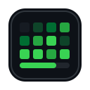
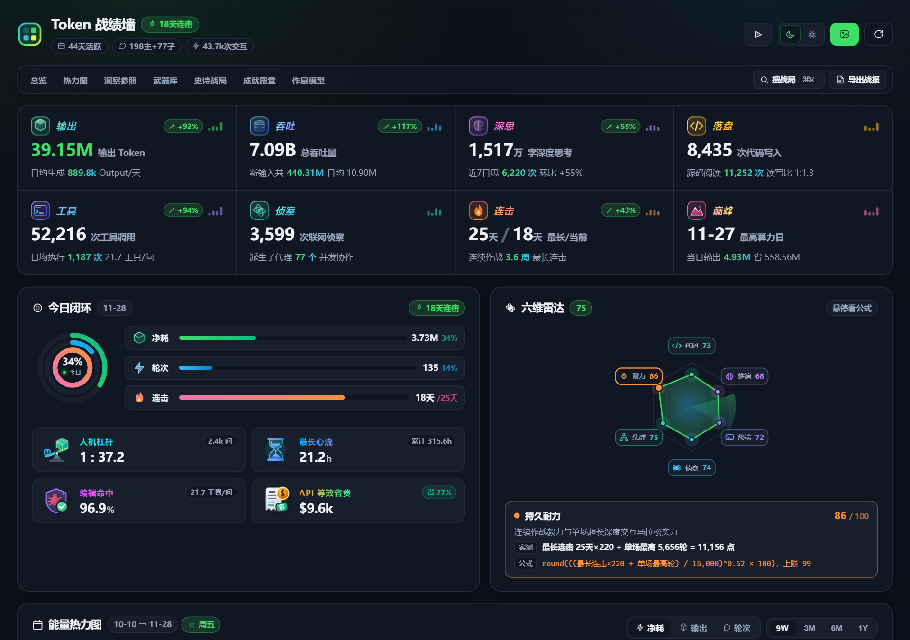
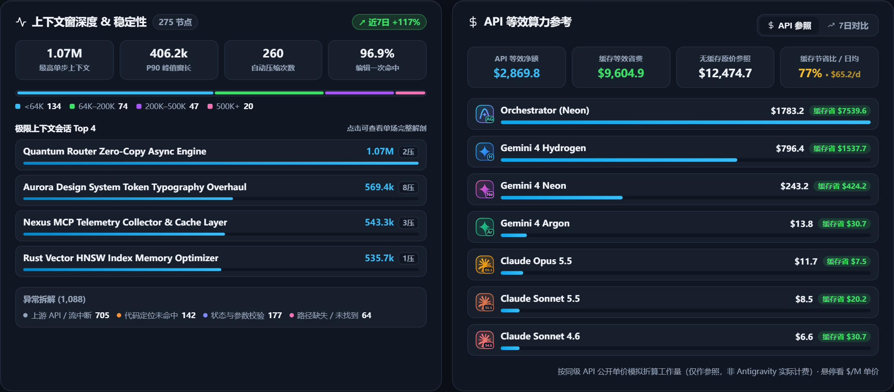
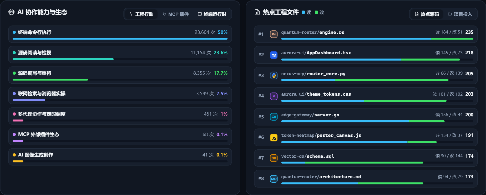
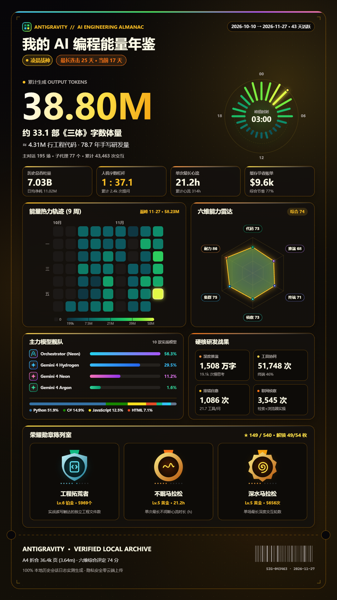

<div align="center">



# Antigravity Token Heatmap Cockpit (`token-heatmap`)

**Local-First AI Engineering Telemetry, Contribution Heatmap, FinOps Ledger & Collectible Almanac for Google Antigravity and Gemini CLI**

**面向 Google Antigravity 与 Gemini CLI 的本地 AI 研发战绩驾驶舱：GitHub 风格 Token 贡献热力图、分模型 FinOps 账单、上下文体检与高清年鉴海报**

[](https://github.com/LEFTX1/antigravity-token-heatmap)
[](https://github.com/LEFTX1/antigravity-token-heatmap)
[](https://modelcontextprotocol.io)
[](#privacy--security)
[](LICENSE)

</div>

---

## One-Command Installation · 一行命令极速安装

### Option 1: Antigravity CLI (`agy`)

```bash
agy plugin install https://github.com/LEFTX1/antigravity-token-heatmap
```

### Option 2: Windows PowerShell (No `agy` CLI needed · 自动配置依赖)

```powershell
irm https://raw.githubusercontent.com/LEFTX1/antigravity-token-heatmap/main/install.ps1 | iex
```

### Option 3: macOS / Linux (`curl`)

```bash
curl -fsSL https://raw.githubusercontent.com/LEFTX1/antigravity-token-heatmap/main/install.sh | bash
```

### Option 4: Google Gemini CLI Extension

```bash
gemini extensions install https://github.com/LEFTX1/antigravity-token-heatmap
```

> **Requirement / 运行要求**：Python 3.10+ (`mcp>=1.2.0`). The installer scripts automatically check and install `mcp`, and the MCP server also auto-bootstraps `mcp` if missing on first launch.

---

## Visual Preview · 实机视觉一览

<p align="center">
  
</p>

<details>
<summary>More Screenshots · 点击展开更多模块预览（FinOps 账单 / 工具武器库 / 黑金年鉴海报）</summary>
<br/>
<p align="center">
  
</p>
<p align="center">
  
</p>
<p align="center">
  
</p>
</details>

---

## Why This Plugin? · 核心模块全景

Built by synthesizing telemetry best practices from `ccusage`, `tokscale`, `CodexBar`, `agentlytics`, Cursor Conversation Insights, WakaTime, Linear Insights, and Apple Fitness / Oura biotelemetry into a single zero-upload **MCP App** running inside Antigravity.

| Module · 模块 | Highlights · 核心亮点 |
| :--- | :--- |
| **Sticky Glassmorphic Cockpit Nav** | Section jump pills, passive scroll-spy highlight, `Ctrl+K` / `⌘K` Command Palette, and 1-click Markdown report export (`导出战报`). |
| **8 KPI Tiles + 7D Rolling Momentum** | Live `↗/↘` 7-day delta pills, micro wave charts, and grounded engineering breakdowns (output per turn, Read/Write ratio, code writes, edit hit rate, unique files touched). |
| **Today Activity Rings & 6-Axis Radar** | Tri-ring daily goals (Fresh Tokens / Turns / Streak), Human-AI leverage ratio, flow endurance, code edit first-pass hit rate, API-equivalent cache savings benchmark, and hoverable 6-axis radar with live exact math formulas. |
| **Energy Contribution Heatmap** | Interactive square grid (`Auto` / `3M` / `6M` / `1Y`), metric switcher (`净耗` / `输出` / `轮次`), live gamma color-scale slider (`γ`) persisted across sessions, and clickable per-day drill-down strip. |
| **Context Health & Heavy Sessions** | Tracks max context window, P90 & average peaks, auto-compaction (`CHECKPOINT`) count, 4 context buckets (`<64K` to `500K+`), prompt-recovered Top-4 heavy sessions, edit first-pass hit rate, and honest error attribution. |
| **API Benchmark & 7D Momentum** | Tiered public API equivalent benchmark (`$saved` by Prompt Cache hits without negative double-counting, strictly sorted) alongside a 7-day vs previous-7-day velocity comparison table. |
| **Engineering Actions, MCP & Projects** | Semantic action distribution (with zero internal RPC plumbing), MCP plugin stats, normalized CLI runtimes (`python` / `powershell` / `node` / `baw`), **path-deduplicated Hot Project Files (`project/file`)**, and smart Project Allocation rankings. |
| **54×10-Tier Collector Medal Hall** | 54 bespoke vector medals across 6 categories with visible acquisition criteria, filterable by category or `未解锁` status, and full 10-tier progression ladder modals. |
| **Single-Session Inspector (`Ctrl+K`)** | Search any past conversation by title, workspace, or date; click any session anywhere to inspect token composition (`Input`/`Cache`/`Output`), per-model collaboration, and tool footprint. |
| **Chronotype, Weekly Rhythm & Fleet** | 24-hour chronotype analysis (`凌晨战神` / `夜航架构师` / etc.), Mon–Sun weekday vs weekend rhythm bars, Top-10 model fleet with readable names + cache hit rings, and weekly stacked evolution / 14-day smooth trend curves. |
| **6-Slide Stories & 3-Theme Posters** | Interactive Spotify-Wrapped-style recap (`←/→` keys) + 1080×1920 Portrait & 1920×1080 Landscape PNG studio in **Obsidian Aurora**, **Ivory Gallery**, and **Obsidian Gold**, supporting `Ctrl+C` native system clipboard copy. |

---

## Usage · 使用方式

After installation, reload MCP servers (or restart Antigravity) and simply ask:

- `"打开我的 Token 热力图与战绩墙"` / `"Open my Token Heatmap"`
- `"查看我的分模型 FinOps 缓存节省和 7 日动量"`
- `"生成一张黑金风格的 AI 编程能量年鉴海报"`

---

## Architecture · 架构说明

```text
~/.gemini/config/plugins/token-heatmap/
├── plugin.json                # Antigravity native plugin manifest
├── gemini-extension.json      # Gemini CLI extension manifest
├── mcp_config.json            # MCP stdio launcher (${PLUGIN_ROOT}, ${PLUGIN_DATA})
├── install.ps1 / install.sh   # 1-command cross-platform installers
├── assets/logo.svg            # Crisp square SVG plugin icon
├── skills/token-heatmap/SKILL.md
├── scripts/
│   ├── heatmap_stats.py       # Transcript JSONL + SQLite aggregator (stat-fingerprinted cache)
│   └── mcp_server.py          # FastMCP App server + native clipboard / PNG save tools
└── ui/app.html                # Self-contained single-file MCP App UI (dark + light themes)
```

---

## Privacy & Security · 隐私与安全声明

- **100% Local Read-Only**: Only reads local session transcripts (`~/.gemini/antigravity*/brain/*/.system_generated/logs/transcript.jsonl` and local metadata DB).
- **Zero Telemetry / Zero Cloud Upload**: No external network requests are ever made by the analytics backend or UI (no external fonts, CDNs, or analytics beacons).
- **Isolated Local Cache**: Derived numeric caches and UI preferences live strictly inside your local plugin data directory (`--data_dir=${PLUGIN_DATA}`).

---

## Keywords & Discovery Tags

`google-antigravity` · `antigravity-plugin` · `antigravity-cli` · `antigravity-skills` · `gemini-cli` · `gemini-cli-extension` · `mcp` · `mcp-app` · `mcp-server` · `token-usage` · `token-heatmap` · `ai-coding-analytics` · `finops` · `ccusage` · `developer-wrapped`

## Sponsor · 赞赏支持

If this plugin makes your AI coding stats more insightful or enjoyable, feel free to buy the author a coffee!  
如果这个插件帮到了你，欢迎请作者喝杯咖啡，感谢支持开源持续迭代 ☕

<table>
  <tr>
    <td align="center">
      <br/>
      <b>微信支付 · WeChat Pay</b>
    </td>
    <td align="center">
      <br/>
      <b>支付宝 · Alipay</b>
    </td>
  </tr>
</table>

---

## License

[MIT License](LICENSE) © 2026 [LEFTX1](https://github.com/LEFTX1)
